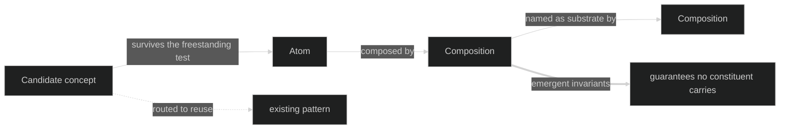

# The Library

The library itself, and the one page that draws its lattice — the four terms everything below is organized by, concept, atom, composition and candidate concept, which the [Glossary](./glossary.md#concept-atom-composition-candidate-concept) defines:

The lattice, argued interactively, an exploration: [**Undoing Undos**](./three-undos.html) — one input stream, three engines, three shapes of the past, and therefore three concepts rather than one with options. Two of its three were written as patterns (Undo History, reversing by replay-skip, retired on 2026-10-20 when Execution Contract Database 5 took its guarantee; [Compensable Workflow](./compositions/compensable-workflow.md), reversing by compensating action); the third — branching undo — is a candidate concept that has not yet faced the freestanding test. The exhibit demonstrates every state of the lattice by accident, which is the best way.

The pages below are the lattice populated, in reading order:

1. [The Method](./method.md): the loops that check each layer against the one above it, the principles, and the thresholds.
2. [GRACE lang](./GRACE-lang.md): the grammar every rule is written in.
3. [Execution Contract](./execution-contract.md): the deterministic target a pattern compiles to, and what any runtime owes it.
4. [Spec Format](./spec-format.md): the sections of a pattern, in order, and the conventions for writing one.
5. [Glossary](./glossary.md): strict definitions for the words the patterns lean on.
6. [Pressure Testing](./pressure-testing.md): the three review passes, what DONE means, and the formal models.
7. [Governance](./governance.md): a draft of how patterns are admitted and how trust is signalled.
8. [Atomic Concepts](./atoms/index.md): the catalogue of atoms.
9. [Conceptual Compositions](./compositions/README.md): the catalogue of compositions.
10. [Composition Graph](./graph.md): which pattern composes which, drawn from the patterns themselves.
11. [Open Questions](./open-questions.md): the decisions deliberately still open, each with what would decide it.
12. [Project Log](./project-log.md): the dated record: the roadmap, the changelog, discoveries, risks and the AI usage log.
