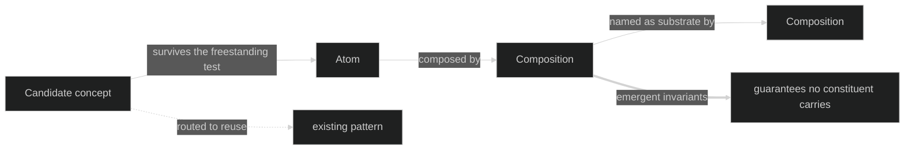

# The Corpus

The library itself, and the one page that draws its lattice — the four terms everything below is organized by, concept, atom, composition and candidate concept, which the [Glossary](./glossary.md#concept-atom-composition-candidate-concept) defines:

The lattice, argued interactively, an exploration: [**Undoing Undos**](./three-undos.html) — one input stream, three engines, three shapes of the past, and therefore three concepts rather than one with options. Two of its three were written as patterns (Undo History, reversing by replay-skip, retired on 2026-10-20 when Execution Contract Database 5 took its guarantee; [Compensable Workflow](./compositions/compensable-workflow.md), reversing by compensating action); the third — branching undo — is a candidate concept that has not yet faced the freestanding test. The exhibit demonstrates every state of the lattice by accident, which is the best way.

The pages below are the lattice populated: the two catalogs, the graph that renders their edges, the format every entry conforms to, and the strict definitions for the handful of English words the specs lean on.
