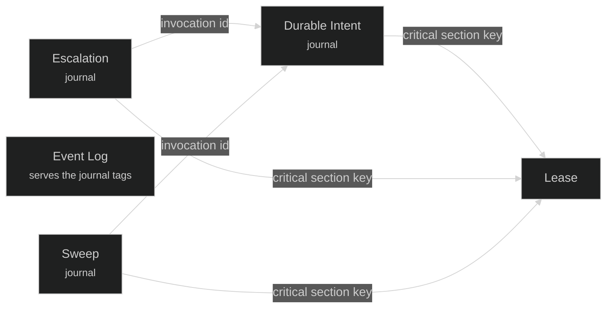

<!-- GENERATED by tools/grace/catalog.py (tools/taxonomy/generate_graph.py runs it) — do not hand-edit;
     regenerate with `python3 tools/taxonomy/generate_graph.py .`. Every node, arrow and count below is
     read from the app page and its atoms' need and offer lines. -->

# Recoverable Invocation as an app: connections

How the atoms of [Recoverable Invocation as an app](./index.md) connect, drawn from their own need and offer lines and the app page's bond instance and glue lines ([Bonds](../../bonds.md)). A need met by an offer so many atoms need that it is drawn as no arrow (an actor id, a journal) is a tag in the needing atom's box.

- **Solid arrow:** a key bond that wires itself; the needing atom points at the atom whose offer meets it.
- **Orange arrow:** a bond instance the app writes, for a need several offers meet.
- **Dashed arrow:** a glue line between the atoms it names (a `glue:` tag where it names one); glue is counted apart and is no bond.

## Tally

**8 bonds**: 3 guard arrows, 2 key arrows, 3 tags (journal 3), and 0 bond instances. **38 glue lines**, which are not bonds: attested append 1, attested append 2, attested append 3, act section 16, commit 1, commit 2, commit 3, commit 4, commit 5, commit 6, commit 7, commit 8, commit 8a, commit 8b, commit 8c, commit 8d, commit 9, commit 15, repeatable 1, repeatable 2, act probe 1, act probe 2, act probe 3, act probe 3a, act probe 4, act probe 5, act probe 6, act probe 7, act probe 7a, act probe 8, act probe 9, journal 6, journal 7, service identity 1, service identity 1a, service identity 1b, service identity 2, service identity 3.

38 of the glue lines name none of the app's atoms by name (`<Atom>'s`), so the diagram draws no arrow or tag for them; the edge list names them.

## Edges

| From | To | Kind | Word | Drawn as |
|---|---|---|---|---|
| Durable Intent | Lease | guard | critical section key | arrow |
| Escalation | Lease | guard | critical section key | arrow |
| Escalation | Durable Intent | key | invocation id | arrow |
| Sweep | Lease | guard | critical section key | arrow |
| Sweep | Durable Intent | key | invocation id | arrow |
| Durable Intent | Event Log | journal | closing record, intent record | tag |
| Escalation | Event Log | journal | closing record | tag |
| Sweep | Event Log | journal | closing record, recovery_intended | tag |
| — | — | glue | attested append 1 | not drawn: names no atom |
| — | — | glue | attested append 2 | not drawn: names no atom |
| — | — | glue | attested append 3 | not drawn: names no atom |
| — | — | glue | act section 16 | not drawn: names no atom |
| — | — | glue | commit 1 | not drawn: names no atom |
| — | — | glue | commit 2 | not drawn: names no atom |
| — | — | glue | commit 3 | not drawn: names no atom |
| — | — | glue | commit 4 | not drawn: names no atom |
| — | — | glue | commit 5 | not drawn: names no atom |
| — | — | glue | commit 6 | not drawn: names no atom |
| — | — | glue | commit 7 | not drawn: names no atom |
| — | — | glue | commit 8 | not drawn: names no atom |
| — | — | glue | commit 8a | not drawn: names no atom |
| — | — | glue | commit 8b | not drawn: names no atom |
| — | — | glue | commit 8c | not drawn: names no atom |
| — | — | glue | commit 8d | not drawn: names no atom |
| — | — | glue | commit 9 | not drawn: names no atom |
| — | — | glue | commit 15 | not drawn: names no atom |
| — | — | glue | repeatable 1 | not drawn: names no atom |
| — | — | glue | repeatable 2 | not drawn: names no atom |
| — | — | glue | act probe 1 | not drawn: names no atom |
| — | — | glue | act probe 2 | not drawn: names no atom |
| — | — | glue | act probe 3 | not drawn: names no atom |
| — | — | glue | act probe 3a | not drawn: names no atom |
| — | — | glue | act probe 4 | not drawn: names no atom |
| — | — | glue | act probe 5 | not drawn: names no atom |
| — | — | glue | act probe 6 | not drawn: names no atom |
| — | — | glue | act probe 7 | not drawn: names no atom |
| — | — | glue | act probe 7a | not drawn: names no atom |
| — | — | glue | act probe 8 | not drawn: names no atom |
| — | — | glue | act probe 9 | not drawn: names no atom |
| — | — | glue | journal 6 | not drawn: names no atom |
| — | — | glue | journal 7 | not drawn: names no atom |
| — | — | glue | service identity 1 | not drawn: names no atom |
| — | — | glue | service identity 1a | not drawn: names no atom |
| — | — | glue | service identity 1b | not drawn: names no atom |
| — | — | glue | service identity 2 | not drawn: names no atom |
| — | — | glue | service identity 3 | not drawn: names no atom |
