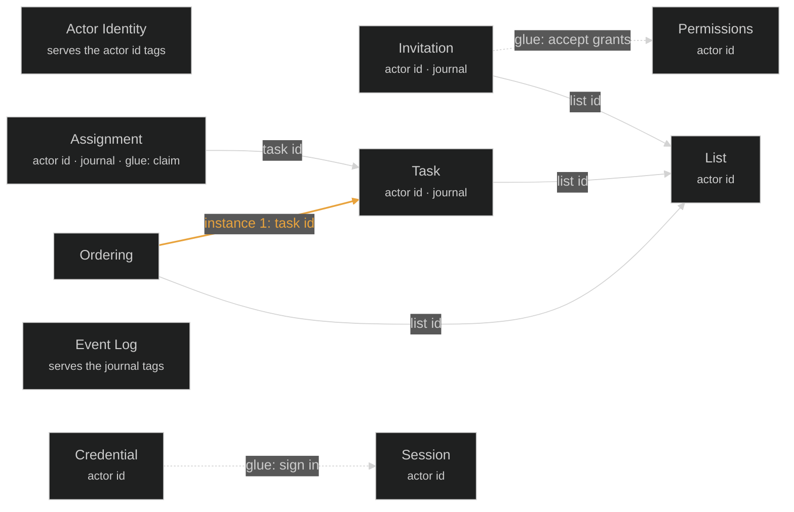

<!-- GENERATED by tools/grace/catalog.py (tools/taxonomy/generate_graph.py runs it) — do not hand-edit;
     regenerate with `python3 tools/taxonomy/generate_graph.py .`. Every node, arrow and count below is
     read from the app page and its atoms' need and offer lines. -->

# Shared Todo as an app: connections

How the atoms of [Shared Todo as an app](./index.md) connect, drawn from their own need and offer lines and the app page's bond instance and glue lines ([Bonds](../../bonds.md)). A need met by an offer so many atoms need that it is drawn as no arrow (an actor id, a journal) is a tag in the needing atom's box.

- **Solid arrow:** a key bond that wires itself; the needing atom points at the atom whose offer meets it.
- **Orange arrow:** a bond instance the app writes, for a need several offers meet.
- **Dashed arrow:** a glue line between the atoms it names (a `glue:` tag where it names one); glue is counted apart and is no bond.

## Tally

**15 bonds**: 4 key arrows, 10 tags (actor id 7, journal 3), and 1 bond instance. **3 glue lines**, which are not bonds: sign in, accept grants, claim.

The app page's own need, no atom's bond and not counted above: permission actor id, met by Permissions.

## Edges

| From | To | Kind | Word | Drawn as |
|---|---|---|---|---|
| Assignment | Task | key | task id | arrow |
| Invitation | List | key | list id | arrow |
| Ordering | List | key | list id | arrow |
| Task | List | key | list id | arrow |
| Assignment | Actor Identity | key | actor id | tag |
| Assignment | Event Log | journal | assignment events | tag |
| Credential | Actor Identity | key | actor id | tag |
| Invitation | Actor Identity | key | actor id | tag |
| Invitation | Event Log | journal | invitation events | tag |
| List | Actor Identity | key | actor id | tag |
| Permissions | Actor Identity | key | actor id | tag |
| Session | Actor Identity | key | actor id | tag |
| Task | Actor Identity | key | actor id | tag |
| Task | Event Log | journal | task events | tag |
| Ordering | Task | key | task id | bond instance 1 |
| Credential | Session | glue | sign in | dashed arrow |
| Invitation | Permissions | glue | accept grants | dashed arrow |
| Assignment | — | glue | claim | tag |
